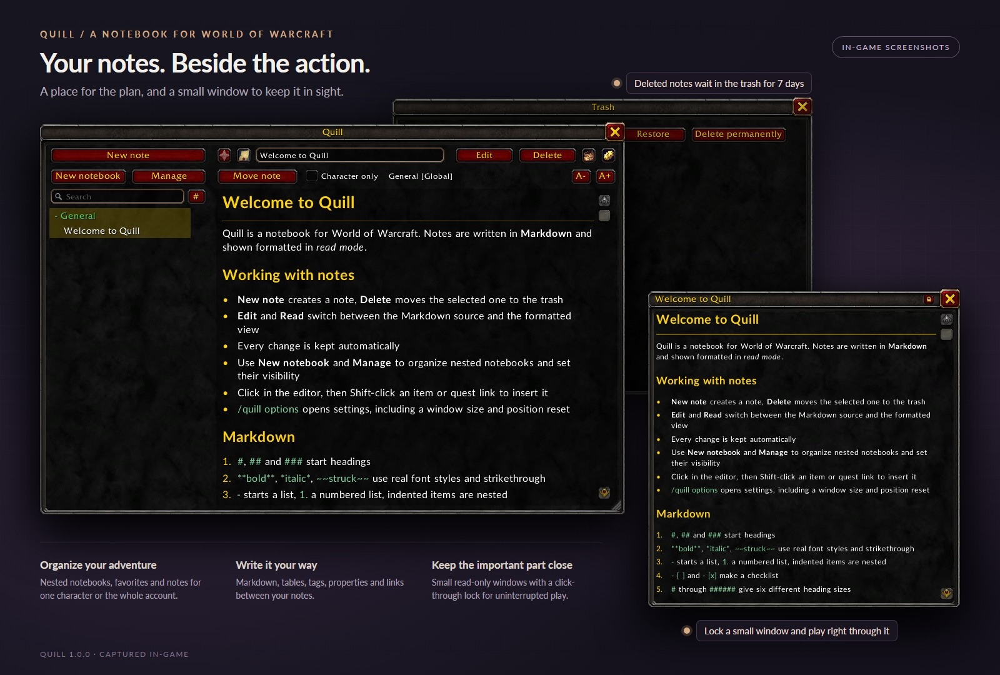
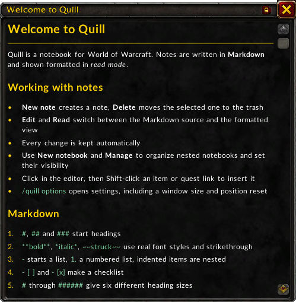
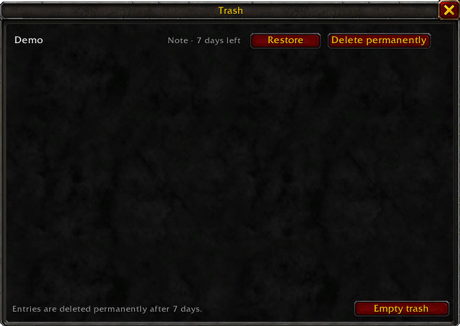

<picture>
  <source media="(prefers-color-scheme: dark)" srcset="assets/header-dark.svg">
  <source media="(prefers-color-scheme: light)" srcset="assets/header.svg">
  
</picture>

<div align="center">

[](CHANGELOG.md)
[](#supported-clients)
[](https://www.lua.org/manual/5.1/)
[](#translations)

[Features](#features) · [Installation](#installation) · [Usage](#usage) · [Markdown](#markdown-in-the-read-mode) · [Saved data](#saved-data) · [Development](#development)

</div>

Quill gives your adventures a place on the page, without leaving World of Warcraft.
Write a boss strategy, keep a character journal or collect your next set of goals. Use
Markdown to turn plain text into readable notes, organize them in notebooks and bring
the important ones along in small windows beside the action.

<p align="center">
  
</p>

## Features

| | What you can do |
| --- | --- |
| **Write and read** | Switch between a Markdown editor and a formatted view with headings, lists, checklists, tables and text colors. |
| **Find your place** | Organize nested, colored notebooks; share them across your account or keep them character-specific. |
| **Connect ideas** | Link notes with `[[wiki links]]`, add tags and YAML properties, and search by text or property. |
| **Keep it close** | Favorite your go-to notes and open several small, read-only windows, with a click-through lock for combat. |
| **Make room for mistakes** | Undo and redo in the editor; restore deleted notes and notebooks from a 7-day trash. |
| **Make it yours** | Choose a background color and opacity, resize your windows and adjust text size independently. |
| **Stay in the game** | Insert native WoW hyperlinks with Shift-click and inspect supported links with game tooltips. |

No external service or companion app is required. Notes are stored locally by WoW.

## Supported clients

Quill declares support for the following client interface versions:

| Client | Interface |
| --- | --- |
| Retail 12.1.0 / 12.1.5 | `120100` / `120105` |
| Classic / Forever 1.60.1 | `16001` |

For Classic Beta, install into `_classic_beta_\Interface\AddOns` instead of
`_retail_\Interface\AddOns`. Beta interface versions can change between builds.

## Installation

1. Download `Quill-<version>.zip` from the [latest release](https://github.com/SiquiL/wow-quill/releases/latest).
2. Extract it into the `Interface\AddOns` folder of the game, e.g.
   `C:\Program Files (x86)\World of Warcraft\_retail_\Interface\AddOns`.
3. Start the game, or restart it if it is running. New addon folders are only detected on
   startup.

> [!IMPORTANT]
> The folder must be named `Quill`, like the `Quill.toc` inside it. The _Source code_ archives
> that GitHub adds to every release unpack to `wow-quill-<version>`; rename that folder to
> `Quill`.

### From source

To work on the addon, link a clone of the repository into the AddOns folder:

```powershell
git clone https://github.com/SiquiL/wow-quill.git
New-Item -ItemType Junction `
  -Path "C:\Program Files (x86)\World of Warcraft\_retail_\Interface\AddOns\Quill" `
  -Target "$PWD\wow-quill"
```

New addon folders are only detected when the game starts. After that, `/reload` loads
changes, unless a file is added to `Quill.toc`.

## Usage

| Command              | Description                     |
| -------------------- | ------------------------------- |
| `/quill`             | Open or close the notebook      |
| `/quill new [title]` | Create a note and edit it       |
| `/quill help`        | List the commands               |
| `/quill options`     | Open the addon settings         |
| `/quill trash`       | Open the trash                  |

Left-click the addon compartment next to the minimap to toggle the notebook; right-click
to open the settings.

- **Resize** the window by dragging its bottom-right corner; its size and position are remembered.
- **New note** creates a note in the selected notebook and opens it in the edit mode. It starts
  as "Untitled" (then "Untitled 2", ...) with the title selected for typing.
- Note titles are unique within a notebook, ignoring surrounding spaces and ASCII case. A title
  already in use turns red and is not saved; leaving the title field restores the last valid
  title. Moving a note into a notebook with the same title is rejected. Other characters'
  private notes are not considered. Duplicates in older saved data are renamed at login: the
  oldest note keeps its name, later ones get " 2", " 3", ... and a chat message reports the count.
  Another character's private notes are resolved when that character logs in.
- **Edit** / **Read** switches between the Markdown source and the formatted view; the last
  mode is remembered.
- **Delete** moves the selected note to the trash after a confirmation.
- The search box filters the list by title and text.
- Every change is kept immediately. The game writes saved variables to disk on logout,
  exit and `/reload`, so a client crash loses the changes since then.
- **Ctrl+Z** undoes and **Ctrl+Y** (or **Ctrl+Shift+Z**) redoes changes in the editor. Typing
  without a pause of more than a second counts as one step; each note keeps up to 100 steps
  until the next `/reload`. Changes made outside the editor, such as a wiki-link rename, start
  a fresh history.
- Right-click a note in the list for **Add to favorites**, **Open in small window** and **Delete**.
- **A-** / **A+** at the right of the second toolbar row change the note text size in both
  read and edit mode, from 75% to 200% in 25% steps. The main window's text size is remembered.

## Favorites

The star left of the title, or the context menu, pins a note. Pinned notes appear in a
**Favorites** section above all notebooks and also stay in their notebook. Click the section
heading to collapse it; a search always shows matching favorites.

## Small note windows

The note-icon button next to the favorites star, or **Open in small window** in the context menu, shows the
note read-only in a separate small window, for example a boss strategy during a fight. Each note
gets its own window, so several can be open at once. They stay open in combat and are not closed
by Escape, only by their close button.

<p align="center">
  
</p>

- Drag the window to move it and its bottom-right corner to resize it. Position, size and the lock
  state are remembered per note; windows are not reopened after `/reload`.
- The lock button next to the close button locks the window: it can no longer be moved or resized
  and lets clicks through to the game world, including links in the note. Its close and lock
  buttons stay clickable.
- The window follows edits, renames and theme changes, and closes when its note is deleted.
- **A-** / **A+** above the note adjust its text size independently of the main window and other
  small windows. The size is remembered per note, including after `/reload`. Headings, code
  and tables resize along with the body text; text wraps to the available window width. The buttons
  are hidden while the window is locked, and the note moves up into their space.

## Trash

Deleted notes and notebooks go to the trash, opened with the basket-icon button in the toolbar or
`/quill trash`. A deleted notebook takes its notes and subnotebooks along and shows up as one
entry. Each entry shows the days left before it is deleted permanently.

<p align="center">
  
</p>

- **Restore** brings the entry back. A note whose notebook is gone returns to the default
  notebook; a note whose title is taken meanwhile gets " 2", " 3", ... A notebook whose parent is
  gone returns at the top level.
- **Delete permanently** and **Empty trash** remove entries for good after a confirmation.
- Entries are deleted automatically 7 days after deletion, at the next login of any character.
  Character-specific entries only appear in that character's trash.

## Text colors

Use `<font color="...">text</font>` in the editor to color text in read mode:

```markdown
- <font color="#9d9d9d">**Poor**</font> (Grey)
- <font color="white">**Common**</font> (White)
- <font color="#1eff00">**Uncommon**</font> (Green)
- <font color="#0070dd">**Rare**</font> (Blue)
- <font color="#a335ee">**Epic**</font> (Purple)
- <font color="#ff8000">**Legendary**</font> (Orange)
```

Supported values are `#RGB`, `#RRGGBB`, and the standard HTML/CSS color names
(including `grey`/`gray`, `white`, `purple`, and `rebeccapurple`), ignoring case.
Names follow CSS values; use the hex examples above for exact WoW item-quality colors.
Colors work with Markdown emphasis, headings, lists, wiki links, tags, and table cells.
Nested font tags restore the outer color when closed. Code keeps its literal contents
and normal code color; native game hyperlinks keep their own item-quality color.
Font tags must open and close within the same Markdown text block or table cell.
Unsupported colors, attributes, and unmatched tags remain visible as text.
This is a text-color extension, not a general HTML renderer: CSS styles, `<span>`,
font sizes, alpha values, and `rgb(...)` are not supported.

## Notebooks and visibility

- The left-hand tree contains notebooks, nested subnotebooks and their notes. Click a notebook
  to select it and expand or collapse its contents. Searching also shows notes in collapsed folders.
- **New notebook** creates a subnotebook of the selected notebook. In its dialog, choose
  **Top level** as the parent to create an independent notebook instead.
- **Manage** renames the selected notebook, changes its parent or sets **Only available to this
  character**. Leaving this unchecked makes it global. A character-specific parent forces its
  descendants to remain character-specific.
- **Notebook color** in **Manage** offers a palette, a custom RGB color and a default reset.
  The notebook name is drawn in its color in the tree and notebook picker. Each notebook has
  its own color, without inheritance.
- Changing a notebook's visibility applies to its notes and its entire subtree. Renaming or
  moving it without a scope change preserves private subnotebooks. Scope changes and deletions
  that would affect another character's private subnotebooks or notes are rejected.
- **Character only** next to **Move note** restricts the selected note to the current character,
  even inside a global notebook. In a character-specific notebook it is always checked and locked.
- **Move note** chooses a new notebook for the selected note. A note in a character-specific
  notebook inherits its visibility; a note marked **Character only** stays private everywhere.
- Deleting a notebook requires confirmation and moves it, its notes and its subnotebooks
  to the [trash](#trash), where they can be restored for 7 days.
- Existing notes are migrated, without changing their text, into **General**, a global default
  notebook. This notebook can be renamed, but cannot be deleted, moved or made character-specific.

Character visibility uses the character's WoW GUID, not its display name. Private notes remain
in the account-wide saved variables, but are not displayed or editable through Quill on other
characters. This is organizational separation, not encryption.

## Wiki links

- Write `[[Note title]]` or `[[Note title|Label]]` in the note. Surrounding spaces and ASCII
  case are ignored; the notebook does not matter.
- In read mode, click the label to open the target. If several accessible notes have the
  same title, a picker showing their notebook paths asks which one to open.
- Missing links have a different color. Clicking offers to create the note in the current
  notebook after confirmation.
- Renaming a note updates uniquely resolved incoming links in accessible notes, preserving
  explicit aliases. Moving notes or renaming notebooks does not affect links. Links in YAML,
  code and game hyperlinks are not rewritten. Ambiguous links and other characters' private
  notes are left untouched.
- Wiki links work in table cells, including aliases. Web URLs and game hyperlinks keep their
  existing behavior. Heading/block links and embeds (`![[...]]`) are not implemented.

## Properties, tags and filters

A YAML frontmatter block at the **very beginning** of a note defines flat properties:

```yaml
---
status: open
level: 80
done: false
tags: [raid, tank]
---
```

Text, finite decimal numbers, booleans and scalar lists are supported. Lists may also use
indented `- value` lines. Property names use ASCII letters, digits, `_` and `-`, starting
with a letter or `_`. Quote text such as `"42"` or `"true"` to keep it a string.
Nested objects, YAML anchors, null values and multiline scalar syntax are not supported.
Invalid frontmatter is reported in read mode, not silently discarded.

Properties are edited directly as YAML in the Markdown editor.
In read mode the properties section can be expanded or collapsed.
The `tags` property is displayed once as clickable hashtags, for example `tags: #test`,
without YAML list brackets or a separate tag row. Inline tags remain in the note body.

Inline `#raid` and nested `#raid/tank` tags join tags from the YAML `tags` property.
The `tags` property may also be written Obsidian-style as `tags: #raid #raid/tank` (or
separated by commas); every entry must then start with `#`.
Headings, escaped tags, code, wiki labels and game hyperlinks do not produce inline tags.
Click an inline tag (or a tag shown under expanded properties) to filter the note tree.
The **#** button next to the search box lists every tag of the visible notes; choose one to
filter, or **All notes** to clear the filter.

Search examples:

| Search | Matches |
| --- | --- |
| `raid plan` | Original substring search across title and source |
| `tag:raid` | YAML/inline tag `raid`, including descendants such as `raid/tank` |
| `tag:raid status:open` | Both conditions (AND) |
| `done:false level:80` | Exact scalar property values |
| `status:"in progress"` | A property value containing spaces |

Filter keys and values ignore ASCII case. List properties match an individual value.
Property filters use equality, not numeric comparisons; OR and saved filters are not
implemented. Invalid query syntax is displayed in the tree. Visibility restrictions
apply before filtering and wiki-link resolution.

## Game hyperlinks

In **Edit** mode, click inside the note's text editor, then Shift-click an item, quest or other
native WoW hyperlink in chat (or a game interface using the standard chat-link insertion).
The link is inserted at the cursor and saved with the note. Other chat edit boxes are not intercepted.
In **Read** mode, links are clickable via the game's normal hyperlink handler. Item, quest,
spell, achievement, currency, battle-pet and enchant links also show their game tooltip on hover;
other types show the link label. Links inside code remain literal text.

## Settings

The engineering-icon button at the right end of the toolbar, next to the trash button, opens Quill's
settings directly. Opening settings is blocked during combat.

Under **Options > AddOns > Quill**, **Reset window size and position** restores the
780 x 520 default size and centers the window, including when it is closed. It does not
change notes, notebooks or their visibility. The panel uses the game's native settings
rows, with reset and bug-report buttons and a **Links** section.

**Theme** applies account-wide to the main window and Quill's own dialogs:
- **Standard** keeps the original dark appearance.
- **Custom color** uses the selected **Background color**, with text colors adjusted for contrast.

**Background opacity** (slider, 0-100 %) applies to every theme, including **Standard**. Only
the backgrounds fade; text, borders and buttons stay opaque. The color picker for
**Background color** also offers an opacity slider that changes the same setting. Below 50 %
opacity the light text palette is kept, because the game world shows through.

Text, links, table styling and editor text follow the theme. Native buttons, input boxes,
confirmation popups and the Blizzard settings page retain their game styling.
Existing notes, notebook colors and window placement are unaffected by theme changes.

The GitHub field next to the GitHub icon is copyable with Ctrl+C.
It links to the Quill repository.

## Markdown in the read mode

| Markdown                                | Shown as                              |
| --------------------------------------- | ------------------------------------- |
| `#` through `######`                    | Six gold, bold heading sizes: 22, 19, 17, 15, 14 and 13 |
| Paragraphs                              | Text; single line breaks are kept     |
| `-`, `*`, `+` and `1.`, `1)`            | Bulleted and numbered lists, nested by indentation |
| `- [ ]`, `- [x]`                        | Checklist items                       |
| `>`                                     | Quote with a bar                      |
| ```` ``` ```` or `~~~` fences           | Code block                            |
| `---`, `***`, `___`                     | Horizontal rule                       |
| `**bold**`, `__bold__`                  | Bold font                             |
| `*italic*`, `_italic_`                  | Italic font; can be combined with bold |
| `~~struck~~`                            | Gray text with a strikethrough line    |
| `` `code` ``, `[text](url)`             | Green code and blue link text         |
| `\| A \| B \|` followed by `\| --- \| --- \|` | Table with a bold header, grid and wrapped cells |
| `\*`                                    | A literal marker                      |

Text is rendered in separate font runs, with real regular, bold, italic and bold-italic faces.
Body text uses size 13. Text and tables reflow when the window is resized.
Table columns have equal widths; `:---`, `:---:` and `---:` select left, center and right
alignment. Escape a pipe in a cell as `\|`, or enclose it in inline code.
Table separators also work when the in-game editor stores pipes in WoW's doubled escape form.
Web links cannot open a browser from the game; only their text is shown. Native WoW hyperlinks
remain interactive. General HTML is not rendered; the supported
[`<font color>` extension](#text-colors) only changes text color.

The bundled [Lato](https://fonts.google.com/specimen/Lato) font files are distributed under
the [SIL Open Font License](fonts/OFL.txt). They are unmodified files from
[Google Fonts](https://github.com/google/fonts/tree/5d3b76120a319730fda218cc7410174a462b32cb/ofl/lato).
Restart the game after first installing new files listed in `Quill.toc` and the fonts; until then,
text uses the standard game font.

## Saved data

Notes, notebooks and settings live in the account-wide `QuillDB` saved variable:

```text
World of Warcraft\<client>\WTF\Account\<ACCOUNT>\SavedVariables\Quill.lua
```

Each client installation keeps its own data; Retail and Classic do not automatically
share notes. Character-specific visibility organizes notes within that data, rather than
putting them in separate files or encrypting them.

Changes are kept in memory immediately. WoW writes them to disk on logout, exit or
`/reload`; a client crash can lose changes since the last save. To back up your journal,
close the game and copy `Quill.lua` somewhere safe. Close the game before restoring a
backup as well, so the current session does not overwrite it.

## Reporting bugs

[Open an issue](https://github.com/SiquiL/wow-quill/issues/new) with your client version,
Quill version, steps to reproduce the problem and any Lua error message. Screenshots
help with layout problems; remove private note contents before sharing them.

In game, **Report a bug** under **Options > AddOns > Quill** opens a dialog with the
issue-page address. Copy it with Ctrl+C and open it in a browser.

## Development

- `luacheck .` checks every Lua file against `.luacheckrc`.
- `lua tests/Core.test.lua` checks migration, nested notebooks, visibility, moves, trash and favorites.
- `lua tests/Markdown.test.lua` runs the parser tests with Lua 5.1 from the repository root.
  These also cover styled word wrapping, measured font widths and UTF-8 boundaries.
- `lua tests/Metadata.test.lua` checks frontmatter parsing, tags and AND queries.
- `lua tests/UI.test.lua` checks rendering, resizing, notebook dialogs, chat-link insertion,
  tag menu, wiki navigation, colors, themes, settings, undo/redo, favorites, small note windows
  and the trash using mocked game APIs.
  Visual validation still requires WoW.

| File               | Content                                                |
| ------------------ | ------------------------------------------------------ |
| `Markdown.lua`     | Markdown parser: blocks and inline escape sequences    |
| `Metadata.lua`     | Flat YAML frontmatter, tags and search queries         |
| `Wiki.lua`         | Wiki-link resolution, creation and rename updates      |
| `Appearance.lua`   | Themes, notebook colors and native color picker        |
| `TextLayout.lua`   | Word wrapping across styled text runs                 |
| `Core.lua`         | Saved variables, note functions, slash command         |
| `NotebookUI.lua`   | Notebook management and destination selection dialogs |
| `UI.lua`           | Window, note list, editor and rendered read mode       |
| `Popout.lua`       | Small read-only note windows                           |
| `Trash.lua`        | Trash dialog                                           |
| `Settings.lua`     | Addon settings, window reset and repository link       |
| `locales/`         | English texts and German translation                   |

Saved variables (`QuillDB`, schema version 2): `notes[id] = { title, text, created, modified, notebook, owner, pinned, deleted }`,
`notebooks[id] = { title, parent, owner, color = { r, g, b }, deleted }` (`owner` is a character GUID, or nil for global;
`deleted` is the deletion time of a trash entry),
`defaultNotebook`, `nextId`, `nextNotebookId`,
`settings = { selected, notebook, mode, theme, textScale, backgroundColor = { r, g, b }, window = { point, relativePoint, x, y, width, height },
popouts[noteId] = { point, relativePoint, x, y, width, height, locked, textScale } }`.
Properties remain in each note's Markdown text rather than a second saved-data store.

### Translations

Quill follows the game's language: German clients use `locales/deDE.lua`; all other
clients fall back to English in `locales/enUS.lua`. Keep both files in sync when adding
or changing interface text.

### Releasing

Add the release to [CHANGELOG.md](CHANGELOG.md), raise `## Version` in `Quill.toc` and commit.
Then tag that commit and build a zip whose top folder is `Quill`, so it can be extracted into
`Interface\AddOns` as it is:

```powershell
git tag v1.0.0
git push origin main v1.0.0
git archive --format zip --prefix Quill/ --output Quill-1.0.0.zip v1.0.0
```

Create the GitHub release from that tag, use the CHANGELOG section as its description and
attach `Quill-1.0.0.zip`.

`.gitattributes` marks everything the game does not load (README, CHANGELOG, ROADMAP, artwork,
tests and the tool configuration) as `export-ignore`. Runtime files such as `fonts` and `textures` remain
in both this zip and the _Source code_ archives that GitHub generates.
